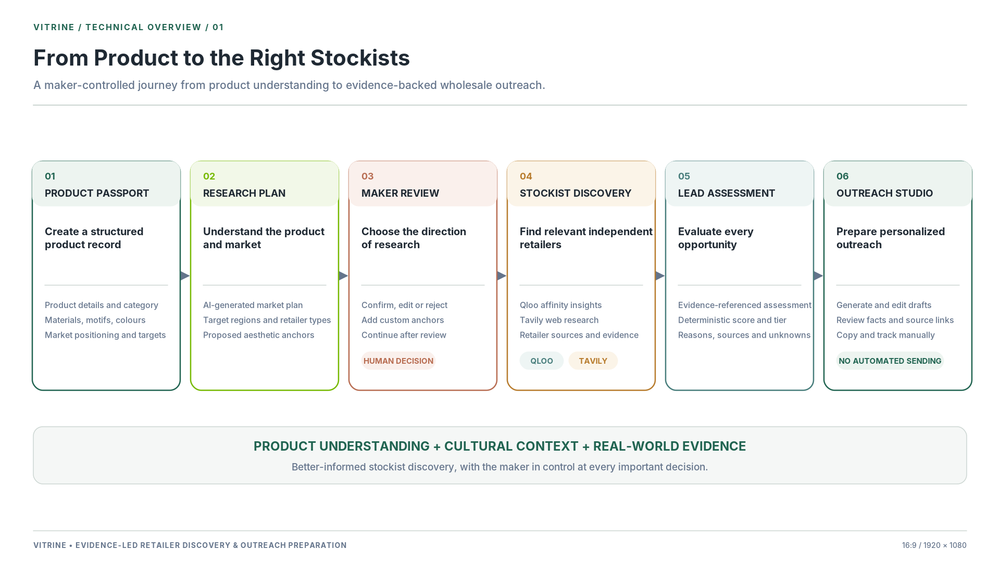
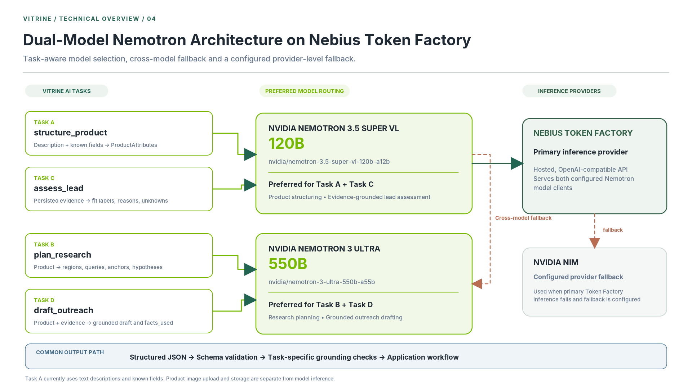
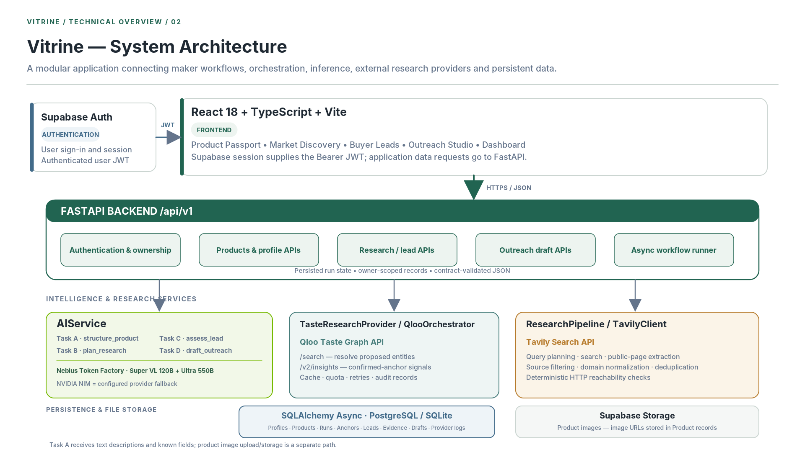
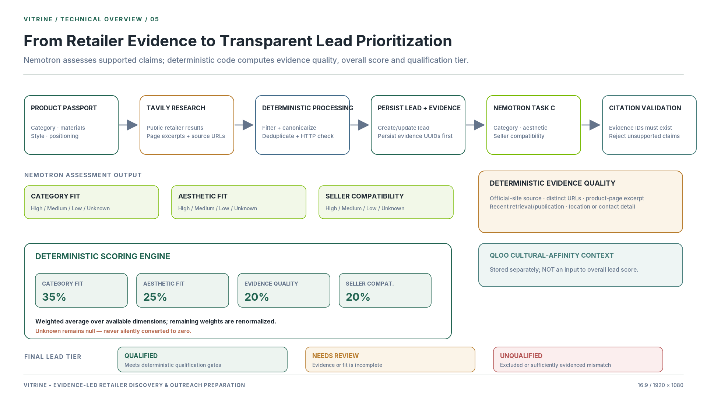
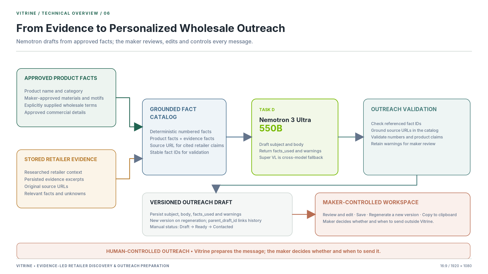

<div align="center">

# Vitrine
### Boutique Wholesale Atelier for Independent Physical-Product Brands

[](https://fastapi.tiangolo.com) [](https://react.dev) [](https://www.typescriptlang.org) [](https://tailwindcss.com) [](https://build.nvidia.com) [](https://tokenfactory.nebius.com) [](https://qloo.com) [](https://tavily.com) []()

<p align="center">
<strong>Boutique stockist discovery, cultural taste evaluation, and wholesale outreach preparation for craft studios and physical product brands.</strong>
</p>

<p align="center">
<strong>Architecture:</strong> <strong>Qloo Taste Graph API</strong> &bull; <strong>Dual NVIDIA Nemotron Models on Nebius Token Factory</strong> (550B Ultra &amp; 120B Super VL) &bull; <strong>Tavily AI Search</strong> &bull; <strong>FastAPI</strong> &bull; <strong>Supabase</strong> &bull; <strong>React 18</strong>
</p>

</div>

---

## The Problem

<div align="justify">

Independent craft studios, ceramicists, and textile workshops make high-quality physical products, but finding overseas stockists manually is slow and inefficient:

* **Cold email spam hurts reputations:** Generic B2B sales automation tools scrape directory lists and blast retail buyers with mass templates. Curated boutique owners treat these messages as spam, which damages the maker's credibility.
* **Keyword search misses aesthetic context:** Independent boutiques, museum stores, and design shops curate based on aesthetic alignment, craft traditions, and design philosophy (such as wabi-sabi, botanical dyeing, or mid-century modern). Traditional search engines index keyword density rather than curated retail aesthetics.
* **Manual verification takes weeks:** Researching individual stores across different countries, checking whether they are currently open, reviewing their price tiers against wholesale margins, and finding the right contact details takes hours for every store.

</div>

---

## The Solution

<div align="justify">

Vitrine is a wholesale workspace designed for independent makers. It replaces speculative directory scraping with verified store evidence and cultural affinity mapping. The platform unites three core systems into a cohesive pipeline: **Qloo Taste Graph API** maps craft aesthetics to retail demographics; **NVIDIA Nemotron on Nebius Token Factory** provides dual-model inference with 550B Ultra for strategic planning and 120B Super VL for fast multimodal extraction; and **Tavily AI Search** discovers operational independent boutiques with live website evidence. Every store recommendation is cross-referenced against real website excerpts, keeping the maker in control of outreach with no automated email dispatch.

</div>

<div align="center">
  
</div>

---

## Architecture and Core Capabilities

### 1. Cultural Taste Intelligence (Qloo Taste Graph API)

<div align="justify">

Rather than matching superficial keywords, Vitrine queries the **Qloo Taste Graph** to map artisan design motifs (such as madder root dyes, botanical woodblocks, wabi-sabi ceramics, or heritage brassware) to real-world cultural entities, design movements, and boutique demographics in target regions:

- **Entity Resolution and Taste Anchors:** Product attributes and studio notes resolve via Qloo `/search` and `/v2/insights` into structured cultural taste anchors.
- **Cross-Domain Demographic Mapping:** Bridges the gap between craft materials and retail culture by identifying consumer demographic overlaps between design movements and curated lifestyle stockists.
- **Hypothesis Enrichment:** Discovered taste signals attach directly to market hypotheses and populate lead cultural affinity vectors.

</div>

### 2. Dual-Model Foundation AI (NVIDIA Nemotron on Nebius Token Factory)

<div align="justify">

Vitrine deploys a dual-tier foundation model architecture orchestrated through the OpenAI-compatible **Nebius Token Factory API** (`https://api.tokenfactory.nebius.com/v1`), matching model capacity to each pipeline stage:

</div>

<div align="center">
  
</div>

<div align="justify">

- **NVIDIA Nemotron 3.5 Super VL (120B):** Multimodal extraction (Task A) and concurrent lead scoring (Task C). Optimized for sub-2s latency, high-throughput multimodal parsing, and parallel evaluation via async semaphores.
- **NVIDIA Nemotron 3 Ultra (550B):** Strategic market planning (Task B) and grounded wholesale copywriting (Task D). Provides deep reasoning across hypothesis spaces and human-fluent outreach drafts without robotic phrasing.

*(Nebius Token Factory endpoints: `nvidia/nemotron-3.5-super-vl-120b-a12b` and `nvidia/nemotron-3-ultra-550b-a55b` with automated cross-model fallback)*

</div>

### 3. Live Web Discovery and Verification (Tavily AI Search)

<div align="justify">

- **Targeted Live Discovery:** Queries live web sources combining confirmed product categories, target regions, and Qloo-derived taste vectors to discover real, operational boutique stockists.
- **Seller-in-the-Loop Confirmation:** Rather than scraping the web blindly, candidate boutiques are prioritized for in-depth excerpt scraping based on maker confirmation, keeping pipeline execution efficient.
- **Canonical Normalization:** Domain normalization prevents duplicate stockists across international searches.
- **Untrusted Web Isolation:** Scraped store content is strictly encapsulated within `<untrusted_retailer_evidence>` envelopes to guard against prompt injection.

</div>

### 4. Data Integrity and Production Safeguards

<div align="justify">

- **Zero Hallucination Checks:** Automated post-generation claim validators (`validate_lead_assessment_claims`, `validate_and_ground_outreach_draft`) check every pitch assertion and fit rationale against stored web excerpts. Unsupported assertions are blocked.
- **Preservation of Unknown Truths:** In wholesale evaluation, absent information is not a negative mark. If a boutique's minimum order policies are not publicly disclosed, Vitrine explicitly displays **"Not enough evidence"** (`null`), never coercing missing values to zero.
- **Production Fixture Fallback Blocker:** In production environments (`APP_ENV=production`), missing upstream API credentials return an explicit HTTP 503 error (`upstream_unavailable`) rather than silently serving mock fixtures. Offline fixture execution is preserved strictly for local development and unit tests.
- **Domain Verification:** RDAP domain-age verification and canonical email checks screen out dormant domains, newly registered shell sites, and mismatched contacts.

</div>

### 5. Direct Seller Control (No Automated Emailing)

<div align="justify">

Vitrine intentionally excludes autonomous mass-mailing. The platform contains no automated email-sending APIs and no mass send buttons. Generated pitches are editable drafts with transparent fact citations. The maker reviews, personalizes, copies to their clipboard, and reaches out directly through their own email client.

</div>

### 6. Accessible Portal UI Architecture

<div align="justify">

- **Centralized Viewport Modal Architecture:** Built with React portals mounted directly to `document.body` with focus trapping, `Escape` key handling, and background scroll-locking. This eliminates the CSS transform containing-block bug where fixed modal dialogs get trapped inside scrolling parent containers.
- **Craft-Focused Design System:** Tailored for physical product studios using Aubergine (`#4A154B`), Vermilion (`#CF1E1E`), Deep Ink, Warm Canvas (`#F8F6F7`), and Space Grotesk / Inter typography.

</div>

---

## System Architecture

<div align="center">
  
</div>

---

## Repository Structure

```
Vitrine/
├── backend/                        # FastAPI asynchronous application
│   ├── ai/                         # Dual Nemotron service, prompts & claim validation
│   │   ├── client.py               # OpenAI-compatible client with cross-model fallback
│   │   ├── prompts.py              # Strict Pydantic-enforced system prompts
│   │   └── service.py              # AIService interface & production safeguards
│   ├── app/                        # REST API routing, lifespan & dependencies
│   │   ├── auth/                   # Asymmetric (ES256/RS256) & symmetric JWT verification
│   │   ├── db/                     # Async SQLAlchemy 2.0 models & migrations
│   │   └── main.py                 # FastAPI application factory & middleware
│   ├── integrations/               # Qloo Taste Graph API adapter & mock fallback
│   ├── research/                   # Tavily web crawler, scoring & pipeline execution
│   └── tests/                      # 130 comprehensive pytest suites
│
├── frontend/                       # Vite 6 + React 18 + TypeScript SPA
│   ├── src/
│   │   ├── api/                    # Contract-first HTTP client & typed resources
│   │   ├── components/             # Reusable UI primitives (EvidenceCard, ScoreBar, Modal)
│   │   ├── features/               # Core feature domains
│   │   │   ├── auth/               # Maker authentication & onboarding
│   │   │   ├── dashboard/          # Atelier overview & pipeline metrics
│   │   │   ├── products/           # Product Passport catalog & AI extraction
│   │   │   ├── discovery/          # Market Discovery & Taste Anchor review
│   │   │   ├── leads/              # Discovered Buyer Leads & detail view
│   │   │   ├── outreach/           # Grounded pitch workspace & versioning
│   │   │   └── landing/            # Editorial public showcase & walkthrough
│   │   └── index.css               # Design system tokens & reset
│   └── package.json                # Dependencies & scripts
│
├── contracts/                      # Single source of truth: Pydantic & wire schemas
│   └── schemas.py                  # Strict wire models, enums & error definitions
├── docs/                           # Architectural records, design system & handoffs
├── eval/                           # Retailer evaluation harness & benchmark scenarios
├── openapi.json                    # Exported OpenAPI 3.1 specification
└── vitrine.db                      # Local SQLite development database (auto-created)
```

---

## Quickstart Guide

### Prerequisites
- **Python 3.11+**
- **Node.js 18+** and `npm`

### 1. Clone the Repository
```bash
git clone https://github.com/lakshyajn/Vitrine.git
cd Vitrine
```

### 2. Configure Environment Variables
Vitrine includes a template configured to run out-of-the-box:

```bash
# Set up backend environment
cp .env.example .env

# Set up frontend environment
cp .env.example frontend/.env
```

#### Key Settings (`.env`):
```env
# 1. Application & Database
APP_ENV=dev
ALLOW_DEV_TOKENS=true
DATABASE_URL=sqlite+aiosqlite:///./vitrine.db
CORS_ORIGINS=http://localhost:5173,http://127.0.0.1:5173

# 2. Dual Nemotron AI (Nebius Token Factory / NVIDIA NIM)
NEBIUS_BASE_URL=https://api.tokenfactory.nebius.com/v1
NEBIUS_API_KEY=your-nebius-or-nvidia-key
NEBIUS_MODEL_ID=nvidia/nemotron-3-ultra-550b-a55b

NEMOTRON_FAST_BASE_URL=https://api.tokenfactory.nebius.com/v1
NEMOTRON_FAST_API_KEY=your-nebius-or-nvidia-fast-key
NEMOTRON_FAST_MODEL_ID=nvidia/nemotron-3.5-super-vl-120b-a12b

# 3. Live Web Discovery (Tavily Search API)
TAVILY_API_KEY=your-tavily-api-key

# 4. Cultural Taste Intelligence (Qloo API)
QLOO_API_KEY=your-qloo-api-key
QLOO_BASE_URL=https://api.qloo.com
```

*Note on Offline Execution:* If external API keys are omitted in development (`APP_ENV=dev`), Vitrine falls back to local fixtures so the end-to-end workflow can be tested without network dependencies.

### 3. Launch Backend API
```bash
# Create and activate virtual environment
python -m venv .venv
source .venv/bin/activate  # On Windows: .venv\Scripts\activate

# Install dependencies
pip install -r backend/requirements.txt

# Start FastAPI server with live reload
uvicorn backend.app.main:app --host 127.0.0.1 --port 8000 --reload
```
* Interactive Swagger API docs: [http://127.0.0.1:8000/docs](http://127.0.0.1:8000/docs)
* Health check endpoint: [http://127.0.0.1:8000/health](http://127.0.0.1:8000/health)

### 4. Launch Frontend Application
```bash
# In a separate terminal
cd frontend
npm install
npm run dev
```
* Vitrine interface will be live at: **[http://localhost:5173](http://localhost:5173)**

---

## Verification Suite

Vitrine maintains a test pipeline covering contract validation, security boundaries, and frontend component workflows.

```
Total Automated Tests: 167 Passing
├── Backend Pytest Suite:  130 / 130 Passing (0 failures)
└── Frontend Vitest Suite:   37 / 37 Passing (0 failures)
```

### Run Backend Tests (130 Tests)
```bash
pytest backend/tests/ -v
pytest backend/tests/test_contracts.py backend/tests/test_production_safeguards.py -v
```

### Run Frontend Verification (37 Tests + Static Analysis)
```bash
cd frontend

# Run unit and integration tests
npm test

# Run strict TypeScript compiler verification (0 errors)
npm run typecheck

# Run ESLint across entire codebase (0 errors, 0 warnings)
npm run lint

# Build production bundle
npm run build
```

### Run Evaluation Benchmark Harness
```bash
python -m eval.run_eval
```
* Evaluates domain extraction, Pydantic schema validation (100%), and claim verification across benchmark scenarios.

---

## Application Workbenches

### 1. Product Passport (`/app/products`)
* Product modeling: title, category, wholesale pricing ranges (`USD`, `EUR`, `GBP`), minimum order quantities (MOQ), monthly craft capacity, and materials provenance.
* **AI Attribute Extraction:** Paste raw studio notes or workshop specifications to extract structured attributes using Nemotron 3.5 Super VL, with field-by-field review before saving.

### 2. Market Discovery (`/app/discovery`)
* Launch research runs targeted by product, geography (such as Western Europe, UK, Japan, or North America), and store format.
* **Interactive Taste Anchor Review:** Review proposed aesthetic anchors (such as wabi-sabi tableware or botanical dye textiles) with one-click confirmation, rejection, custom additions, and instant undo recovery.
* Live polling stepper tracks research execution across all 7 pipeline stages.

<div align="center">
  
</div>

### 3. Buyer Leads Explorer (`/app/leads`)
* Discovered stockists categorized into qualification tiers: `Qualified`, `Needs Review`, and `Unqualified`.
* Multi-dimensional fit scoring: Category Alignment, Aesthetic Vector, and Commercial Wholesale Compatibility.
* Clear separation of verified retailer facts from match hypotheses. Null values explicitly render as *"Not enough evidence"*.
* Secondary duplicate markers flag sister stores and affiliated domains.

<div align="center">
  
</div>

### 4. Buyer Lead Detail (`/app/leads/:id`)
* Inspection of verified store excerpts, official domain status, and cultural affinity vectors.
* Direct access to extracted web evidence snippets with source URLs and timestamped verification.

### 5. Outreach Studio (`/app/outreach/:leadId`)
* Evidence-grounded wholesale inquiries generated by Nemotron 3 Ultra (550B).
* **Facts-Used Citations Inspector:** Highlights specific store facts and product attributes cited in the draft.
* Version tracking, draft customization, and single-click copy to clipboard.
* Manual outreach tracking (`draft` -> `ready` -> `contacted`) synchronizes with lead status.

<div align="center">
  
</div>

---

## Security and Data Isolation

<div align="justify">

- **Tenant Isolation:** Every product, run, lead, and outreach draft is scoped to the authenticated caller's `owner_id`. Cross-user access returns HTTP 404.
- **Asymmetric Token Verification:** Production tokens are verified via dynamic JWKS key retrieval from Supabase with full audience, issuer, expiry, and UUID `sub` validation. Symmetric HS256 is supported with strict rejection of `alg=none`.
- **Secret Redaction:** Integration endpoints (`/api/v1/integrations/status`) report live/mock provider availability without exposing API keys, key prefixes, or credentials.
- **Rate Limiting:** Sliding-window rate limiters protect compute-intensive endpoints (`POST /api/v1/research-runs` and `POST /api/v1/leads/{id}/outreach-drafts`).
- **Resilient Recovery:** Background jobs automatically detect runs stalled beyond `STAGE_TIMEOUT_SECONDS` (120s) and transition them safely to `failed`.

</div>

---

## License

Vitrine is licensed under the **MIT License**. See [LICENSE](LICENSE) for details.
