<div align="center">

# 🪟 Vitrine
### *Boutique Wholesale Atelier for Independent Physical-Product Brands*

[](https://fastapi.tiangolo.com)
[](https://react.dev)
[](https://www.typescriptlang.org)
[](https://build.nvidia.com)
[](https://qloo.com)
[](https://tavily.com)
[]()

**Evidence-backed boutique discovery and seller-controlled wholesale outreach.**  
*Zero automated spam. Zero hallucinated claims. 100% grounded in verified retailer facts.*

---

</div>

## 📌 The Problem
Independent artisan workshops and physical-product makers craft exceptional goods (hand block-printed textiles, bespoke ceramics, handcrafted leatherware), but expanding into international wholesale is daunting:
* **The Cold Spam Trap:** Generic AI B2B tools scrape contact lists and flood buyers with hallucinated, robotic emails that get reported as spam and burn buyer goodwill.
* **Manual Discovery Is Slow:** Finding authentic independent overseas stockists and concept boutiques aligned with a maker's aesthetic requires hundreds of hours of manual search.
* **Cultural Context Blindness:** Search engines index keywords, but wholesale buyers curate based on **aesthetic affinity, provenance, and cultural fit**.

---

## 💡 The Solution: Vitrine
**Vitrine** is an AI-assisted boutique discovery and wholesale preparation platform designed specifically for artisan workshops. It pairs **multimodal product extraction** with **cultural taste mapping** and **live web verification** to connect makers with independent retailers who genuinely love their aesthetic.

```mermaid
flowchart LR
    A[Product Passport] -->|Extract Attributes| B(Nemotron Super VL 120B)
    B --> C[Market Hypotheses & Anchors]
    C -->|Taste Intelligence| D[(Qloo Taste Graph)]
    D --> E[Confirmed Taste Anchors]
    E -->|Live Web Search| F[(Tavily Engine)]
    F -->|Verified Retailer Excerpts| G[Evidence Verification & Dedup]
    G -->|Fast Per-Lead Assessment| H(Nemotron Super VL 120B)
    H -->|Deterministic Scoring| I[Qualified Leads & Fit Tiers]
    I -->|Nuanced Outreach Pitch| J(Nemotron Ultra 550B)
    J --> K[Grounded Pitch Draft & Copy]
```



---

## ⚡ Key Innovations

### 1. 🧠 Dual-Model NVIDIA Nemotron Architecture
Vitrine orchestrates **two distinct NVIDIA Nemotron foundation models** to optimize for both high-throughput speed and deep strategic reasoning:

| Model | Parameters | Role in Vitrine | Why It's Used |
| :--- | :--- | :--- | :--- |
| **`nvidia/nemotron-3.5-super-vl-120b-a12b`** | 120B | **Task A:** Product Structuring<br/>**Task C:** Per-Lead Assessment | High-throughput, rapid multimodal extraction (<2s) across large batches of discovered retailers. |
| **`nvidia/nemotron-3-ultra-550b-a55b`** | 550B | **Task B:** Research Planning<br/>**Task D:** Outreach Copywriting | Deep reasoning for nuanced market hypotheses and persuasive, strictly fact-grounded buyer pitches. |

*Cross-model fallback ensures that if either endpoint encounters upstream rate limits, the alternate model immediately steps in.*

### 2. 🎨 Cultural Affinity & Taste Intelligence (Qloo)
Instead of matching naive keyword queries, Vitrine queries the **Qloo Taste Graph** to map artisan motifs (e.g., *madder root dyes, botanical woodblock, wabi-sabi aesthetics*) to real-world cultural entities, design movements, and boutique demographics in target regions (Western Europe, North America, Japan).

### 3. 🔍 Live Evidence Gathering & Deduplication (Tavily)
Vitrine queries live web sources using **Tavily Search**, validates canonical retailer domains, scrapes authentic store text excerpts, and flags duplicates before any assessment occurs.

### 4. 🛡️ Strict Grounding & Anti-Spam Pledge
* **Zero Hallucinations:** Every claim in an outreach draft or lead assessment must cite an explicit stored `evidence_id` or approved product fact.
* **Unknowns Remain Unknown:** If a boutique's MOQ or wholesale terms are not publicly stated, Vitrine reports *"Not enough evidence"* rather than coercing scores to zero.
* **Seller-in-the-Loop:** **No automated email sending and no Send button.** Vitrine produces grounded drafts for the artisan to review, personalize, copy, and track manually.

---

## 🗺️ Product Tour: The 8-Step Seller Journey

1. **Sign Up & Atelier Profile:** The maker sets basic workshop details and export capacity.
2. **Product Passport:** Upload product images or paste free text. **Nemotron Super VL 120B** suggests structured attributes (materials, motifs, price segment, MOQ); the maker reviews and confirms.
3. **Research Run Initialization:** Maker selects the target product and international regions. **Nemotron Ultra 550B** plans market hypotheses and aesthetic candidates.
4. **Anchor Review:** Maker reviews, confirms, or edits proposed cultural and design anchors.
5. **Taste Resolution & Live Discovery:** Confirmed anchors resolve through the **Qloo Taste Provider**, and the **Tavily Pipeline** discovers authentic overseas boutiques.
6. **Assess & Score:** **Nemotron Super VL 120B** evaluates lead fit against stored web excerpts. A deterministic engine scores leads into `Qualified`, `Needs Review`, and `Unqualified` tiers.
7. **Lead Inspection:** Maker explores curated boutique cards, verifies source URLs, reviews confidence labels, and inspects explicit unknowns.
8. **Outreach Studio:** **Nemotron Ultra 550B** crafts a personalized, evidence-grounded wholesale pitch citing verified facts. Maker edits, copies to clipboard, and tracks status manually.

---

## 🛠️ Architecture & Tech Stack

### Frontend (`frontend/`)
- **Framework:** React 18 + TypeScript + Vite
- **Styling:** Tailwind CSS + Radix UI / Shadcn primitives
- **Icons:** Lucide React
- **Data Visualization:** AG Studio Pro & interactive fit dimension badges
- **Testing:** Vitest + React Testing Library (13/13 unit tests passed)

### Backend (`backend/`)
- **Framework:** FastAPI (Python 3.11) with ASGI asynchronous pipeline
- **Database & ORM:** SQLite / PostgreSQL with SQLAlchemy 2.0 (asyncio)
- **Validation:** Pydantic v2 Contract-First Schemas ([contracts/schemas.py](contracts/schemas.py))
- **Security:** Supabase JWT verification, timing-safe tokens, automated secret redaction logging filter
- **Testing:** Pytest + AnyIO (107/107 unit & integration tests passed)

### External Integrations
- **AI Reasoning:** NVIDIA Cloud Functions / Nebius (`nemotron-3-ultra-550b`, `nemotron-3.5-super-vl-120b`)
- **Taste Graph:** Qloo API (`/search`, `/v2/insights`)
- **Web Discovery:** Tavily AI Search API

---

## 🚀 Quickstart Guide (3 Minutes)

### Prerequisites
- Python 3.11+
- Node.js 18+ and `npm`

### 1. Clone the Repository
```bash
git clone https://github.com/lakshyajn/Vitrine.git
cd Vitrine
```

### 2. Configure Environment Variables
Copy `.env.example` to `.env`:
```bash
cp .env.example .env
```
Fill in your API keys (or leave blank to automatically run in offline fixture mode):
```env
# AI Models (NVIDIA Integrate / Nebius)
NEBIUS_BASE_URL=https://integrate.api.nvidia.com/v1
NEBIUS_API_KEY=your-nvidia-api-key
NEBIUS_MODEL_ID=nvidia/nemotron-3-ultra-550b-a55b

NEMOTRON_FAST_BASE_URL=https://integrate.api.nvidia.com/v1
NEMOTRON_FAST_API_KEY=your-nvidia-fast-api-key
NEMOTRON_FAST_MODEL_ID=nvidia/nemotron-3.5-super-vl-120b-a12b

# Search & Taste APIs
TAVILY_API_KEY=your-tavily-key
QLOO_API_KEY=your-qloo-key

# App & Auth Settings
APP_ENV=dev
SUPABASE_JWT_SECRET=dev-secret-key-32-chars-minimum
```

### 3. Run Backend Server
```bash
# Install Python dependencies
python -m pip install -r backend/requirements.txt  # or: pip install fastapi uvicorn sqlalchemy pydantic httpx pyjwt

# Start FastAPI application
python -m uvicorn backend.app.main:app --host 0.0.0.0 --port 8000 --reload
```
*API Swagger Documentation will be available at [http://localhost:8000/docs](http://localhost:8000/docs).*

### 4. Run Frontend Client
```bash
cd frontend
npm install
npm run dev
```
*Atelier UI will be live at [http://localhost:5173](http://localhost:5173).*

---

## 🧪 Testing & Verification

Vitrine includes an exhaustive test suite covering contracts, deterministic scoring, secret redaction, and live AI pipelines:

```bash
# Run all backend unit & integration tests (107 tests)
python -m pytest -v

# Run WS3 Retailer Evaluation Harness against live Tavily + Nemotron
python -m eval.run_eval

# Run frontend tests & type check
cd frontend
npm test
npm run typecheck
npm run build
```

---

## 📊 Evaluation Harness Results
Running `python -m eval.run_eval` against the sample artisan workshop scenario yielded:
- **Discovered Boutique Candidates:** 27 verified domains
- **Pydantic Contract Validity Rate:** 100%
- **Unsupported / Hallucinated Claims:** 0 (blocked by deterministic post-check)
- **Fit Scoring Determinism:** 100% reproducible across runs

---

## 👥 Hackathon Team & Project Info
- **Project Name:** Vitrine
- **Tagline:** Boutique Wholesale Atelier
- **Designed for:** Global Hackathon Submission
- **License:** MIT License

*Empowering independent makers to reach the international boutiques where their craftsmanship belongs.*
