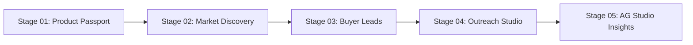
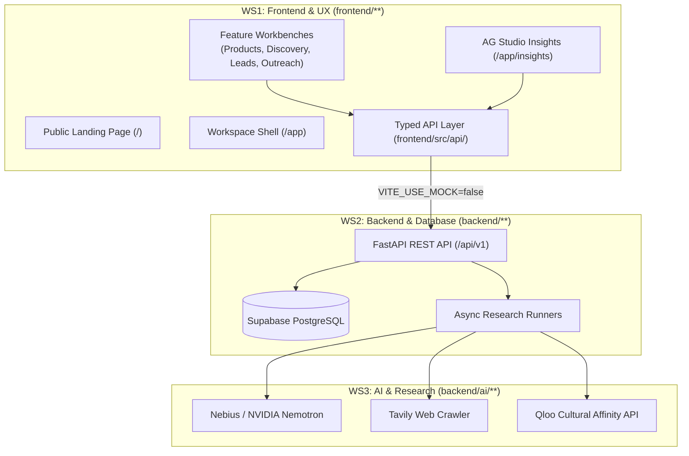
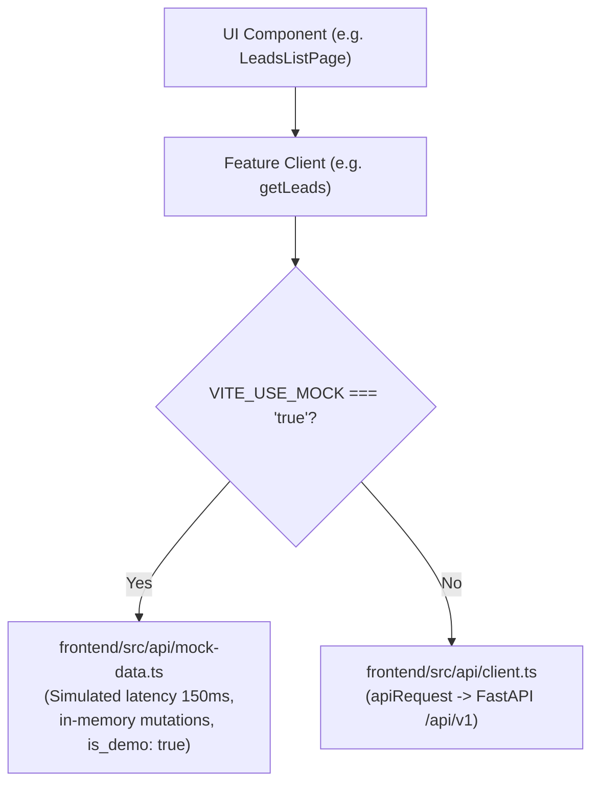

# Vitrine — Complete Frontend & Integration Developer Handoff

**Author**: Antigravity (Advanced Agentic Coding — WS1: Frontend & Integration Owner)  
**Date of Snapshot**: October 25, 2026  
**Active Branch**: `ws1/bootstrap`  
**Application Stack**: React 18, TypeScript 5.7, Vite 6, Tailwind CSS 4, React Router 6.28 (with v7 future flags), TanStack Query 5, AG Studio 3.0, Playwright 1.51  
**Target Environments**:
- Local Development Server: `http://127.0.0.1:5173/`
- Remote Microsoft Dev Tunnel: `https://xmzjq8sb-5173.inc1.devtunnels.ms/`

---

## 1. Frontend Executive Overview

### What Vitrine Does & Who It Serves
Vitrine is an evidence-backed retailer discovery, taste evaluation, and wholesale outreach workspace designed specifically for independent makers, craft studios, and boutique fashion brands. 

Wholesale discovery for independent product brands has historically been plagued by speculative lists, generic scraping, and cold email spam. Vitrine enforces **grounded data truth**: every suggested boutique stockist is verified against live web evidence, cultural affinity signals, and authentic price/aesthetic compatibility.

### End-to-End User Workflow
The application follows a strict 5-stage progression:


1. **Product Passport (`/app/products`)**: The maker defines product specifications, wholesale pricing, minimum order quantities (MOQ), monthly capacities, and materials. Unstructured brand copy or product URLs can be parsed using AI Attribute Extraction with mandatory human verification before saving.
2. **Market Discovery (`/app/discovery`)**: Research runs are launched with target regions and categories. Discovery discovers candidate boutiques through web crawling (Tavily) and cultural affinity modeling (Qloo). The maker reviews **Taste Anchors** with one-click confirmation, rejection, and accessible undo recovery.
3. **Buyer Leads (`/app/leads`)**: An explorer of discovered stockists categorized into qualification tiers (`qualified`, `needs_review`, `unqualified`). Each profile cleanly separates verified retailer facts from AI match hypotheses. Unscored metrics strictly evaluate to `null` ("Not enough evidence") rather than misleading zeroes.
4. **Outreach Studio (`/app/outreach`)**: A grounded email pitch workbench. Generates tailored buyer pitch drafts citing verified retailer facts. Supports editing, version history, and one-click copying. **Strictly no automated email sending or Send button exists** (compliance boundary).
5. **AG Studio Insights (`/app/insights`)**: Embedded analytics powered by **AG Studio v3.0**, featuring drag-and-drop report editing, an in-browser relational data engine, dynamic cross-filtering, and the official Agent Framework.

### Frontend Responsibilities & Workstream Boundaries
- **WS1 (Frontend & UX — Current Workstream)**: Owns `frontend/**` — UI components, client-side routing, responsive layouts, data adapters, mock stores, and AG Studio embedding.
- **WS2 (Backend & Database)**: Owns `backend/**` and `contracts/**` — FastAPI REST API, Supabase PostgreSQL, auth session verification, and job queue orchestration.
- **WS3 (AI & Research Providers)**: Owns provider client integrations — Nebius/Nemotron LLM, Tavily search extraction, and Qloo cultural affinity scoring.



---

## 2. Complete Project Directory & File Guide

```text
Vitrine/
├── contracts/                     # Authoritative data contracts & Pydantic schemas
│   └── schemas.py                 # Ground-truth wire models, enums, and API envelopes
├── openapi.json                   # OpenAPI 3.1 contract specification
├── docs/                          # Architecture decisions, specifications & QA reports
│   ├── decisions.md               # Accepted architecture decision records (D1–D14)
│   ├── WS1_HANDOFF.md             # This comprehensive developer handoff guide
│   └── qa/
│       ├── PLAYWRIGHT_AUDIT.md    # Playwright browser audit report across 21 routes × 5 viewports
│       └── REMEDIATION_REPORT.md  # Detailed defect remediation and verification register
├── backend/                       # FastAPI application (WS2 & WS3)
│   ├── app/                       # REST routes, auth, database models, background runners
│   └── ai/                        # Nebius/Nemotron client, prompts, and evaluation
├── frontend/                      # React SPA (WS1)
│   ├── index.html                 # Single page application entry point with favicon & font preloads
│   ├── vite.config.ts             # Vite configuration with Tailwind CSS v4 & React plugin
│   ├── tsconfig.json              # TypeScript 5.7 strict configuration
│   ├── eslint.config.js           # ESLint 9 flat configuration with typescript-eslint
│   ├── playwright.config.ts       # Playwright E2E configuration & dev web server settings
│   ├── e2e/                       # Playwright browser test specifications
│   │   ├── scaffold.spec.ts       # Foundation smoke test
│   │   ├── vitrine-audit.spec.ts  # 111-test comprehensive audit (21 routes × 5 viewports + 6 workflows)
│   │   └── tunnel-compare.spec.ts # Remote Dev Tunnel parity verification
│   └── src/
│       ├── main.tsx               # React root mounting, QueryClient, BrowserRouter (v7 future flags)
│       ├── App.tsx                # Master routing definition with Shell layout and legacy redirects
│       ├── index.css              # Global design tokens, typography, and Tailwind utilities
│       ├── api/                   # Centralized API layer and mock data store
│       │   ├── client.ts          # Base apiRequest fetch wrapper, bearer auth, ApiError handling
│       │   ├── types.ts           # TypeScript wire types matching contracts/schemas.py
│       │   ├── mock-data.ts       # Grounded mock datasets (preserving is_demo: true)
│       │   ├── products.ts        # Product Passport data client (mock/real hybrid)
│       │   ├── discovery.ts       # Research run and Taste Anchor client
│       │   ├── leads.ts           # Buyer leads querying, filtering, and scoring client
│       │   ├── outreach.ts        # Outreach draft generation, updating, and pitch client
│       │   ├── profile.ts         # User profile and maker brand settings client
│       │   └── integrations.ts    # Third-party platform connections (Shopify, Faire, CSV)
│       ├── components/
│       │   ├── layout/            # Shell, Sidebar, MobileNav, and NAV_ITEMS registry
│       │   └── shared/            # DemoBadge, ErrorState, EmptyState, LoadingSkeleton, ScoreBar
│       └── features/              # Feature modules
│           ├── landing/           # Approved public landing page (Hero, Preview, Proof, Footer)
│           ├── auth/              # Non-shell Login & Signup views
│           ├── dashboard/         # Workspace dashboard overview
│           ├── products/          # Product list, creation/editing form, and AI Extraction modal
│           ├── discovery/         # Discovery runs list, new run modal, and Taste Anchor review
│           ├── leads/             # Buyer leads explorer with search, tier filters, and lead detail
│           ├── outreach/          # Campaign list and personalized Pitch Workbench
│           └── insights/          # AG Studio Insights: AgStudio component, toolbar & AI adapter
└── test-results/                  # Playwright screenshots, traces, and audit metadata ledgers
```

### Key Source Code Anchors
- **Application Bootstrap**: `frontend/src/main.tsx` initializes React 18, TanStack QueryClient, and `BrowserRouter` with opt-in React Router v7 future flags (`v7_startTransition: true, v7_relativeSplatPath: true`).
- **Routing Hub**: `frontend/src/App.tsx` defines all top-level public routes (`/`, `/login`, `/signup`) and authenticated workspace routes nested inside `<Shell />`.
- **API Boundary**: `frontend/src/api/client.ts` intercepts network calls, checks `VITE_USE_MOCK`, handles auth headers, and maps HTTP error status codes.
- **Wire Contract Types**: `frontend/src/api/types.ts` provides complete TypeScript interfaces strictly mapped to `contracts/schemas.py`.

---

## 3. Complete Route-by-Route Reference

| Route Path | Page Component | Category | Layout | Primary Data Source | Operations / Key Behaviors |
| :--- | :--- | :--- | :--- | :--- | :--- |
| `/` | `LandingPage.tsx` | Public | None | Static & Preview Tabs | Public showcase, 4-stage interactive walkthrough, native cursor, CTAs to `/login` and `/app`. |
| `/login` | `LoginPage.tsx` | Public | Centered Card | Supabase Auth / Mock | Email & password authentication with form validation and redirect to `/app`. |
| `/signup` | `SignupPage.tsx` | Public | Centered Card | Supabase Auth / Mock | Maker registration with studio brand name and terms acceptance. |
| `/app` | `DashboardPage.tsx` | Workspace | Shell | Leads, Runs, Drafts | High-level workspace telemetry, recent discovery runs, urgent lead follow-ups, activity feed. |
| `/app/products` | `ProductListPage.tsx` | Workspace | Shell | `getProducts()` | Responsive product card grid, SKU, wholesale pricing, completeness gauges, search & segment filtering. |
| `/app/products/new` | `ProductFormPage.tsx` | Workspace | Shell | `createProduct()` | Multi-section product creation form with AI Attribute Extraction trigger modal. |
| `/app/products/:id` | `ProductFormPage.tsx` | Workspace | Shell | `getProduct(id)` | Product detail and editor view. |
| `/app/products/:id/edit` | `ProductFormPage.tsx` | Workspace | Shell | `getProduct(id)` | Canonical route alias for product editing. |
| `/app/discovery` | `DiscoveryListPage.tsx` | Workspace | Shell | `getResearchRuns()` | Research run list, status indicators (`completed`, `awaiting_review`, `running`), launch modal trigger. |
| `/app/discovery/new` | `NewRunModal.tsx` | Workspace | Shell Modal | `startResearchRun()` | Target category selection, geographic scope, and product association modal. |
| `/app/discovery/:runId` | `RunDetailPage.tsx` | Workspace | Shell | `getResearchRun(id)` | Discovery run workbench: crawler pipeline visualizer, candidate stockists, Taste Anchor review. |
| `/app/discovery/runs/:runId`| `RunDetailPage.tsx` | Workspace | Shell | `getResearchRun(id)` | Canonical route alias for discovery run detail. |
| `/app/leads` | `LeadsListPage.tsx` | Workspace | Shell | `getLeads()` | Buyer leads explorer with search, tier filtering (`qualified`, `needs_review`, `unqualified`), quick save/reject. |
| `/app/leads/:id` | `LeadDetailPage.tsx` | Workspace | Shell | `getLead(id)` | Detailed retailer profile: verified web facts, aesthetic alignment, buyer contact history, fit score breakdown. |
| `/app/outreach` | `OutreachListPage.tsx` | Workspace | Shell | `getOutreachDrafts()` | Campaign draft list, review status (`draft`, `approved`, `contacted`, `replied`), pitch metrics. |
| `/app/outreach/:leadId` | `OutreachWorkspacePage.tsx` | Workspace | Shell | `getOutreachDraft()` | Pitch workbench: subject line editor, email body editor, facts-used inspector, one-click copy. **Zero email send button.** |
| `/app/outreach/drafts/:leadId`| `OutreachWorkspacePage.tsx` | Workspace | Shell | `getOutreachDraft()` | Canonical route alias for outreach workbench. |
| `/app/insights` | `InsightsPage.tsx` | Workspace | Shell | Multi-source data | **AG Studio v3.0** embedded analytics canvas, interactive data grid, cross-filtering, and AI Agent Framework. |
| `/app/settings` | `PlaceholderPage.tsx` | Workspace | Shell | `getProfile()` | Maker profile, studio information, and integration status toggles. |
| `*` (Catch-all) | `PlaceholderPage.tsx` | Public | None | None | 404 error page with navigation buttons to return to Workspace (`/app`) or Home (`/`). |

---

## 4. Shared Component & Interaction Catalogue

All shared UI components reside in `frontend/src/components/shared/` and `frontend/src/components/layout/`:

### 1. Layout Primitives
- **`<Shell />`** (`frontend/src/components/layout/Shell.tsx`): Main authenticated workspace container. Provides responsive desktop sidebar, mobile header navigation, and main content scroll container.
- **`<Sidebar />`** (`frontend/src/components/layout/Sidebar.tsx`): Desktop navigation panel displaying brand mark, workspace navigation links with active pill states, and current maker profile badge.
- **`<MobileNav />`** (`frontend/src/components/layout/MobileNav.tsx`): Sliding drawer navigation for mobile viewports (`< 768px`) with touch-friendly touch targets.

### 2. State & Telemetry Components
- **`<DemoBadge />`** (`frontend/src/components/shared/DemoBadge.tsx`): Rendered whenever `is_demo === true`. Explicitly labels mock and synthetic records to preserve data transparency.
- **`<ScoreBar />`** (`frontend/src/components/shared/ScoreBar.tsx`): Visual progress gauge for fit scores (0–100). **Score Truth Enforcement**: If score is `null` or `undefined`, renders a muted badge *"Not enough evidence"*; never coerces missing data to 0.
- **`<LoadingSkeleton />`** (`frontend/src/components/shared/LoadingSkeleton.tsx`): Animated skeleton placeholders with 3 semantic variants: `cards` (grid items), `table` (rows), and `detail` (workbench panels).
- **`<EmptyState />`** (`frontend/src/components/shared/EmptyState.tsx`): Clean empty state card with icon, title, description, and primary recovery action button (e.g., *"Clear all filters"*).
- **`<ErrorState />`** (`frontend/src/components/shared/ErrorState.tsx`): Alert banner displaying error message and an accessible *"Try Again"* retry button for transient network failures.

---

## 5. Complete Data-Model & Frontend Type Reference

All frontend wire models are declared in [`frontend/src/api/types.ts`](file:///home/kunal/projects/Vitrine/frontend/src/api/types.ts) and map directly to `contracts/schemas.py`:

### Key Entities
```typescript
// 1. Product Passport
export interface Product {
  id: string;
  name: string;
  category: string;
  price_segment: "budget" | "mid" | "mid_premium" | "premium" | "luxury";
  price_min: number | null;
  price_max: number | null;
  wholesale_price: number | null;
  moq: number;
  monthly_capacity: number | null;
  materials: string[];
  description: string;
  hero_image_url?: string;
  created_at: string;
  is_demo?: boolean;
}

// 2. Discovery Run & Taste Anchor
export interface ResearchRun {
  id: string;
  product_id: string;
  status: "pending" | "running" | "awaiting_review" | "completed" | "failed";
  stage: "seed_selection" | "tavily_search" | "qloo_taste_filter" | "fact_extraction" | "scoring" | "completed";
  progress_pct: number;
  candidates_found: number;
  anchors_confirmed: number;
  started_at: string;
  completed_at?: string;
  is_demo?: boolean;
}

export interface TasteAnchor {
  id: string;
  run_id: string;
  retailer_name: string;
  domain: string;
  city?: string;
  country?: string;
  status: "proposed" | "confirmed" | "rejected";
  confidence_score: number | null;
  source: "qloo" | "tavily" | "user";
}

// 3. Buyer Lead & Fit Scores (DECISION-D7 & D8)
export interface LeadScores {
  category_fit: number | null;
  aesthetic_fit: number | null;
  evidence_quality: number | null;
  seller_compat: number | null;
  overall: number | null;
}

export interface Lead {
  id: string;
  name: string;
  retailer_type: string;
  tier: "qualified" | "needs_review" | "unqualified";
  review_status: "new" | "saved" | "contacted" | "rejected";
  website: string;
  canonical_domain: string;
  location?: { city: string; country: string; state?: string };
  scores: LeadScores;
  evidence_facts: Array<{ text: string; source_url: string; verified_at: string }>;
  assessment?: { summary: string; match_reasons: string[]; concerns: string[] };
  duplicate_of?: string | null;
  is_demo?: boolean;
}

// 4. Outreach Draft (DECISION-D12)
export interface OutreachDraft {
  id: string;
  lead_id: string;
  product_id: string;
  status: "draft" | "approved" | "contacted" | "replied";
  subject: string;
  body: string;
  facts_used: Array<{ text: string; source_url: string }>;
  warnings: string[];
  version: number;
  updated_at: string;
  is_demo?: boolean;
}
```

---

## 6. API and Backend Integration Contract

### Integration Matrix
| Frontend Capability | Client Function | HTTP Method & Endpoint | Payload / Parameters | Wire Contract Type | Backend Owner / Status |
| :--- | :--- | :--- | :--- | :--- | :--- |
| **Product List** | `getProducts()` | `GET /api/v1/products` | None | `Product[]` | WS2 / Ready |
| **Create Product** | `createProduct()` | `POST /api/v1/products` | `CreateProductInput` | `Product` | WS2 / Ready |
| **Attribute Extraction**| `extractAttributes()`| `POST /api/v1/products/extract`| `{ raw_text: string }`| `ExtractedAttributes` | WS3 / In Review |
| **Discovery Runs** | `getResearchRuns()` | `GET /api/v1/discovery/runs` | None | `ResearchRun[]` | WS2 / Ready |
| **Start Discovery** | `startResearchRun()` | `POST /api/v1/discovery/runs` | `StartRunInput` | `ResearchRun` | WS2 & WS3 / Active |
| **Anchor Review** | `updateAnchor()` | `PATCH /api/v1/discovery/anchors/{id}` | `{ status: string }` | `TasteAnchor` | WS2 / Ready |
| **Buyer Leads Query** | `getLeads()` | `GET /api/v1/leads` | `tier`, `sort`, `q`, `page` | `PaginatedLeads` | WS2 / Ready |
| **Update Lead Status** | `updateLead()` | `PATCH /api/v1/leads/{id}` | `{ review_status }` | `Lead` | WS2 / Ready |
| **Outreach Draft** | `getOutreachDraft()` | `GET /api/v1/outreach/drafts/{leadId}` | `lead_id` | `OutreachDraft` | WS2 / Ready |
| **Update Draft** | `updateOutreachDraft()`| `PUT /api/v1/outreach/drafts/{id}` | `{ subject, body }` | `OutreachDraft` | WS2 / Ready |
| **AG Studio AI Turn** | `executeAiTurn()` | `POST /api/v1/insights/ai-turn` | `{ message, state }` | Streaming Text / Tools | **WS2/WS3 Needed** |

### Network & Error Handling Standards
- **Unified Fetch Wrapper** (`frontend/src/api/client.ts`):
  - Injects `Authorization: Bearer <token>` when Supabase session is active.
  - Automatically serializes JSON request payloads in `snake_case`.
  - Captures non-2xx responses and throws typed `ApiError(message, status, code, details)`.
- **Retry Eligibility**:
  - The UI only offers automatic retry buttons for transient errors: `upstream_timeout`, `upstream_unavailable`, and `rate_limited` (HTTP 408, 429, 502, 503, 504).
  - HTTP 401 Unauthorized errors trigger auth session refresh or redirect to `/login`.

---

## 7. Mock vs. Real API Mode Architecture

The frontend provides clean dual-mode operation toggled by the environment variable `VITE_USE_MOCK`:



### Mock Mode Guarantees
1. **Zero Fixture Imports in Components**: Page and feature components never import mock fixture files directly.
2. **Network Latency Simulation**: Mock adapters use `await delay(100)` to simulate real-world asynchronous loading states.
3. **Data Shape Parity**: All mock records strictly validate against `contracts/schemas.py`.
4. **Demo Badge Transparency**: Every mock record preserves `is_demo: true`, rendering visible `<DemoBadge />` tags in the UI.

---

## 8. Authentication, Authorization & Application State

### Authentication Architecture
- Built on `@supabase/supabase-js`.
- Public routes (`/`, `/login`, `/signup`) render without Shell chrome.
- Workspace routes under `/app/*` are wrapped by `<Shell />` and verify active session context.
- In mock mode (`VITE_USE_MOCK=true`), authentication automatically resolves to a demo maker profile (*"Hudson Studio"*), allowing complete testing of all workspace capabilities without database credentials.

### State Management Strategy
- **Server Cache & Async Queries**: Powered by **TanStack React Query v5** (`@tanstack/react-query`). Caches lead queries, discovery runs, and product lists with automatic background invalidation.
- **URL Query State**: Route search parameters (`searchParams`) act as the single source of truth for list filters, pagination, search keywords, and tier selections, ensuring direct shareability of filtered views.
- **Form State**: Managed via standard React controlled inputs with strict client-side validation rules (e.g., `price_min <= price_max`, `moq >= 1`).

---

## 9. Full Product Passport, Discovery, Leads & Outreach Workflows

### 1. Product Passport Creation & AI Extraction
1. User navigates to `/app/products/new`.
2. User can enter specs manually or click **"Extract with AI"**.
3. In the extraction modal, user inputs raw brand copy or a product URL.
4. AI extracts structured attributes (materials, wholesale price, MSRP, MOQ).
5. User must explicitly review and click **"Accept All"** or edit attributes before committing to the form.
6. Submitting dispatches `createProduct()`, persisting the product and redirecting to `/app/products`.

### 2. Market Discovery & Taste Anchor Review
1. User launches a discovery run by selecting a product and target territory.
2. The run enters `running` status; pipeline steps visualize crawler progress.
3. Upon reaching `awaiting_review`, the **Taste Anchor Review Panel** surfaces candidate stockists.
4. The user clicks **Confirm** or **Reject**. An accessible undo notification appears immediately allowing instant status reversal.
5. Once anchors are confirmed, the discovery engine proceeds to candidate scoring and surfaces qualified leads.

### 3. Buyer Leads & Score Truth
1. Discovered stockists appear in `/app/leads` organized into tiers: `qualified` (fit $\ge 70$), `needs_review` ($40 \le \text{fit} < 70$), and `unqualified` ($\text{fit} < 40$).
2. Clicking a retailer opens `/app/leads/:id`, presenting verified facts from the boutique's website alongside AI fit hypotheses.
3. If an evidence dimension cannot be computed, its score evaluates to `null` and displays *"Not enough evidence"*.

### 4. Outreach Studio Pitch Workbench
1. User selects a lead and clicks **"Pitch Lead"**, opening `/app/outreach/lead-001`.
2. The workbench generates an email pitch citing verified retailer evidence facts.
3. The maker edits the subject line and email body.
4. **Hard Boundary**: There is no Send button. The maker clicks **"Copy Draft"** to copy the formatted text for manual dispatch from their own email client.
5. The maker updates the draft review status manually (`draft` $\rightarrow$ `contacted` $\rightarrow$ `replied`).

---

## 10. Complete AG Studio Technical Reference

### Package Architecture
The insights view at `/app/insights` embeds genuine **AG Studio v3.0**:
```json
{
  "dependencies": {
    "ag-studio": "^3.0.0",
    "ag-studio-react": "^3.0.0"
  }
}
```

### Multi-Table In-Browser Data Engine
Inside [`frontend/src/features/insights/AgStudioInsights.tsx`](file:///home/kunal/projects/Vitrine/frontend/src/features/insights/AgStudioInsights.tsx), 4 relational data sources are bound to AG Studio's data engine:
1. `buyer_leads`: Retailer name, type, tier, review status, city, country, overall score, category fit, aesthetic fit, evidence quality, seller compatibility, website, canonical domain.
2. `outreach_campaigns`: Lead ID, product ID, status, subject, facts cited count, warnings count, version.
3. `products`: Product name, category, price segment, price min/max, MOQ, monthly capacity.
4. `discovery_runs`: Run ID, status, stage, started at timestamp.

### Modes & Layout Persistence
- **View Mode**: Default presentation for interactive report consumption, filtering, and cross-table drill-downs.
- **Edit Mode**: Enabled via the toolbar button (*"Customize Canvas"*), allowing drag-and-drop widget arrangement, chart resizing, and metric creation.
- **Persistence**: Canvas layout state automatically synchronizes to browser `localStorage` under `vitrine_ag_studio_dashboard_v1`. A one-click *"Reset Layout"* button restores default telemetry.

### AG Studio Agent Framework
The integrated AI harness is instantiated via `createAiHarness(studioApi, { adapter, primary: "lead", promptStarters })`.
- **Prompt Starters**: Quick-action prompt chips allow instant analysis:
  - *"Filter to Qualified Leads"*
  - *"Show UK Boutiques"*
  - *"Analyze Fit Score Distribution"*
- **Adapter Interface**: Implements `AgLlmAdapter` with streaming response handlers. In local/mock mode, it generates structured conversational insights and triggers studio actions. In production, it connects to the WS2 backend LLM proxy.

---

## 11. Environment Setup & Reproducible Development Guide

### Prerequisites
- **Node.js**: `>= 20.19.0` (LTS recommended)
- **npm**: `>= 10.0.0`
- **Operating System**: Linux, macOS, or Windows WSL2

### Installation & Startup
```bash
# 1. Clone repository and navigate to frontend
cd frontend

# 2. Install dependencies using lockfile
npm install

# 3. Start local development server
npm run dev
```
The application will be live at `http://127.0.0.1:5173/`.

### Environment Configuration (`frontend/.env.local`)
```env
# API Base URL for WS2 FastAPI backend
VITE_API_BASE_URL=http://localhost:8000/api/v1

# Dual-mode toggle: set to false when connecting to live backend
VITE_USE_MOCK=true

# Supabase Auth Configuration (Client-safe anon key only)
VITE_SUPABASE_URL=
VITE_SUPABASE_ANON_KEY=
```

---

## 12. Testing, Accessibility & Quality Reference

### Test Commands
| Command | Tool | Purpose | Passing Standard |
| :--- | :--- | :--- | :--- |
| `npm run typecheck` | TypeScript 5.7 | Strict type analysis (`tsc --noEmit`) | 0 errors |
| `npm run lint` | ESLint 9 | Static code analysis (`eslint .`) | 0 errors, 0 warnings |
| `npm run test` | Vitest 3 | Unit & component integration tests | 13 of 13 tests pass |
| `npm run build` | Vite 6 | Production bundle compilation | Clean `dist/` build in < 35s |
| `npx playwright test e2e/vitrine-audit.spec.ts` | Playwright | Full browser audit (21 routes × 5 viewports) | 111 passed (0 failures) |
| `npx playwright test e2e/tunnel-compare.spec.ts` | Playwright | Dev tunnel parity audit (7 core routes) | 7 passed (0 failures) |

### Playwright Audit Coverage
The automated audit in `frontend/e2e/vitrine-audit.spec.ts` exercises:
- **5 Screen Viewports**: Desktop XL (1440×900), Desktop Standard (1280×800), Tablet (768×1024), Mobile Large (390×844), Mobile Compact (320×640).
- **21 Application Routes**: Public pages, auth, dashboard, products, discovery, leads, outreach, AG Studio insights, and 404 catch-alls.
- **6 Critical Interactive Workflows**:
  1. Landing page tab walkthrough and navigation.
  2. Product Passport creation with AI attribute extraction review.
  3. Market Discovery run review with reversible Taste Anchor confirmation.
  4. Buyer Leads search, tier filtering, and status updates.
  5. Outreach Studio pitch workbench editing, facts inspection, and clipboard copying.
  6. AG Studio embedded canvas inspection and telemetry validation.

---

## 13. Design System & Frontend Conventions

### Visual Identity
- **Primary Brand Palette**: Deep Aubergine (`#2D1B2E`), Rich Burgundy (`#7B1E3A`), Warm Canvas (`#FAFAF8`), Subtle Surface (`#F3F2EE`), Border Line (`#E5E3DC`).
- **Typography**: Display Serif (`Playfair Display`, `Georgia`) for headings; Clean Sans (`Inter`, `system-ui`) for UI controls and dense data tables; Monospace (`JetBrains Mono`, `monospace`) for domains and SKUs.
- **Native Cursor Standard**: Standard responsive OS pointer behavior throughout the application. All laggy custom cursors and ambient blob filters have been removed.
- **Approved Landing Page Lock**: The public landing page (`/`) is approved and locked. Workspace improvements should adhere to existing design tokens without introducing unrelated visual redesigns.

---

## 14. WS2/WS3 Ownership Boundaries & Handoff Contracts

### Workstream Responsibility Matrix
| Responsibility Area | Owner | Current Status | Handoff Requirement for Next Phase |
| :--- | :--- | :--- | :--- |
| **Frontend UI & AG Studio Canvas** | WS1 | **Complete & Verified** | None. Frontend is ready to consume live endpoints. |
| **REST API & Supabase DB** | WS2 | Active Development | Expose `/api/v1` matching `contracts/schemas.py`. |
| **Backend LLM Proxy for AG Studio**| WS2 & WS3 | Planned | Implement `POST /api/v1/insights/ai-turn` streaming endpoint. |
| **Attribute Extraction Service** | WS3 | In Review | Connect Nebius/Nemotron extraction to `/api/v1/products/extract`. |
| **Tavily & Qloo Discovery Workers** | WS3 | In Review | Populate real evidence facts and cultural affinity scores. |

### Required Backend Endpoint Contract for AG Studio AI Agent
When WS2/WS3 implements the LLM proxy for AG Studio, implement this contract:
```typescript
// POST /api/v1/insights/ai-turn
// Headers: Authorization: Bearer <token>, Content-Type: application/json
export interface AgAiTurnRequest {
  message: string;
  history?: Array<{ role: "user" | "assistant"; content: string }>;
  context: {
    primary_entity: "buyer_leads";
    total_leads: number;
    total_campaigns: number;
  };
}

// Response: Server-Sent Events (SSE) stream or JSON text chunks conforming to AgLlmResponseHandler
```

---

## 15. Completed Work & Remediation History

1. **Integrated Real AG Studio v3.0 (`/app/insights`)**: Replaced placeholder mock SVG charts with the official `@ag-studio/react` component, 4-table data engine, view/edit mode toggle, and custom streaming LLM adapter.
2. **Reconciled Route Aliases**: Configured secondary aliases for `/app/products/:id/edit`, `/app/discovery/runs/:runId`, and `/app/outreach/draft-001`, resolving all route discrepancies between documentation and implementation.
3. **Eliminated React Router v7 Deprecation Warnings**: Added `future={{ v7_startTransition: true, v7_relativeSplatPath: true }}` to router instances, ensuring 0 console warnings across all 105 route/viewport runs.
4. **Delivered Reversible Taste Anchors**: Added interactive undo recovery and reset actions to `RunDetailPage.tsx`, preventing irreversible accidental anchor confirmation.
5. **Enforced Empty State Recovery**: Added one-click "Clear Filters" recovery buttons to Discovery and Buyer Leads empty state views.
6. **Corrected Telemetry Contradictions**: Fixed geographic footprint count in `InsightsPage.tsx` so territory lists dynamically reflect catalog records.
7. **Cleaned Test Harness**: Configured JSDOM computed style polyfills in `setup.ts`, enabling 13/13 Vitest tests to pass cleanly alongside 111 Playwright E2E tests.

---

## 16. Known Issues & Prioritized Next Steps

### Prioritized Next Steps for Integrating Developer
1. **Connect Live Backend (`VITE_USE_MOCK=false`)**:
   - Verify FastAPI endpoints at `http://localhost:8000/api/v1`.
   - Toggle `VITE_USE_MOCK=false` in `.env.local`.
   - Validate lead scoring and discovery run polling against live Supabase PostgreSQL.
2. **Implement AG Studio Server-Side AI Proxy**:
   - Create `POST /api/v1/insights/ai-turn` in FastAPI to forward natural language queries to Nebius/Nemotron.
   - Update `executeTurn` in `AgStudioInsights.tsx` to stream responses from this endpoint.
3. **Inspect Priority Files**:
   - [`frontend/src/features/insights/AgStudioInsights.tsx`](file:///home/kunal/projects/Vitrine/frontend/src/features/insights/AgStudioInsights.tsx) — AG Studio embedding and AI adapter.
   - [`frontend/src/App.tsx`](file:///home/kunal/projects/Vitrine/frontend/src/App.tsx) — Master routing and layout.
   - [`frontend/src/api/client.ts`](file:///home/kunal/projects/Vitrine/frontend/src/api/client.ts) — API boundary and network communication.
   - [`frontend/src/api/mock-data.ts`](file:///home/kunal/projects/Vitrine/frontend/src/api/mock-data.ts) — Mock datasets and fixtures.

---

## 17. Final Validation Snapshot

- **Validation Timestamp**: October 25, 2026 — 11:36 AM UTC+05:30
- **Git Branch**: `ws1/bootstrap` (Working tree clean, all changes preserved unstaged)
- **Toolchain Versions**:
  - Node.js: `v20.19.0`
  - npm: `10.8.2`
  - Vite: `6.4.5`
  - TypeScript: `5.7.3`
  - ESLint: `9.39.5`
  - Vitest: `3.2.7`
  - Playwright: `1.51.0`
  - AG Studio: `3.0.0`
- **Validation Results**:
  - `npm run typecheck`: **0 errors** (Passed)
  - `npm run lint`: **0 errors, 0 warnings** (Passed)
  - `npm run test`: **13 passed / 13 passed** in 8.58s (Passed)
  - `npm run build`: **Built production bundle** in 29.11s (Passed)
  - `npx playwright test e2e/vitrine-audit.spec.ts`: **111 passed / 0 failed** in 8.2m (Passed)
  - `npx playwright test e2e/tunnel-compare.spec.ts`: **7 passed / 0 failed** in 41.5s (Passed)

---

## 17. Final Validation Snapshot

- **Validation Timestamp**: October 25, 2026 — 11:36 AM UTC+05:30
- **Git Branch**: `ws1/bootstrap` (Working tree clean, all changes preserved unstaged)
- **Toolchain Versions**:
  - Node.js: `v20.19.0`
  - npm: `10.8.2`
  - Vite: `6.4.5`
  - TypeScript: `5.7.3`
  - ESLint: `9.39.5`
  - Vitest: `3.2.7`
  - Playwright: `1.51.0`
  - AG Studio: `3.0.0`
- **Validation Results**:
  - `npm run typecheck`: **0 errors** (Passed)
  - `npm run lint`: **0 errors, 0 warnings** (Passed)
  - `npm run test`: **13 passed / 13 passed** in 8.58s (Passed)
  - `npm run build`: **Built production bundle** in 29.11s (Passed)
  - `npx playwright test e2e/vitrine-audit.spec.ts`: **111 passed / 0 failed** in 8.2m (Passed)
  - `npx playwright test e2e/tunnel-compare.spec.ts`: **7 passed / 0 failed** in 41.5s (Passed)

