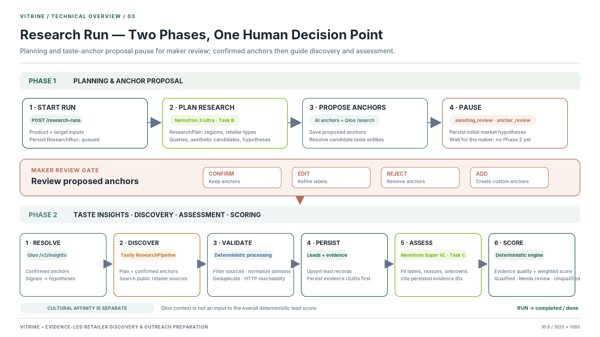

# Frontend & Backend Integration Handoff (`docs/frontend-backend-handoff.md`)

This document records the completed Frontend (WS1), Backend (WS2), and AI Integration (WS3) architecture, endpoint contracts, and handoff alignment for the Vitrine wholesale platform.

---

## 1. Workstream Status Summary

- **Frontend Core:** Complete, typed, tested, and building for production with Vite 6 + React 18 + Tailwind CSS.
- **Contract Fidelity:** 100% compliant with `contracts/schemas.py`, `openapi.json`, and `docs/decisions.md` (Contract v0.2 + Decisions D21–D25).
- **Public Landing Page (`/`):** Frozen, fully approved, editorial boutique art direction with Vermilion `#CF1E1E` CTAs and interactive product walkthrough.
- **Workspace Routes (`/app/*`):** Fully operational across all 5 core workbenches:
  - **Overview Dashboard (`/app`):** Lean, data-derived metrics and quick access.
  - **Product Passport (`/app/products`, `/app/products/new`, `/app/products/:id`):** Multi-currency pricing (`USD`, `EUR`, `GBP`), craft specifications, image upload, direct "Start Discovery" action, and AI Attribute Extraction (`ExtractProfileModal`) with field-by-field acceptance review.
  - **Market Discovery (`/app/discovery`, `/app/discovery/:runId`):** Run initiation, status stepper, polling every 2.5s during `queued`/`running`, and interactive Taste Anchor Review panel (`POST /research-runs/{id}/confirm-anchors`) with instant undo recovery.
  - **Buyer Leads (`/app/leads`, `/app/leads/:id`):** Paged filtering, sorting, tier breakdown, priority fit score (`ScoreBar` with "Not enough evidence" for unknown scores), domain verification, and secondary duplicate markers (`duplicate_of`). Rejection triggers accessible confirmation dialog.
  - **Outreach Studio (`/app/outreach`, `/app/outreach/:leadId`):** Evidence-grounded drafting, facts-used inspector, layout loading skeletons, duration timer (>15s guidance), copy actions, and manual status tracking (`draft` -> `ready` -> `contacted`). Atomic synchronization to parent lead review status on contacted status update.
  - **Auth Integration (`/login`, `/signup`):** Branded artisan sign-in with 1-step signup and Supabase session integration.

  

---

## 2. API Endpoints Map & Implementation Status

* **Health:** `GET /health` &bull; Wire contract: Liveness check &bull; Mode: Live
* **Integrations:** `GET /api/v1/integrations/status` &bull; Wire contract: `IntegrationStatusResponse` &bull; Mode: Live / Mock
* **Seller Profile:** `GET, PUT /api/v1/profile` &bull; Wire contract: `ProfileUpdate` -> `Profile` &bull; Mode: Supabase JWT
* **Product Passport:** `GET, POST /api/v1/products`, `PATCH, DELETE /products/{id}` &bull; Wire contract: `ProductCreate`, `ProductUpdate` -> `Product` &bull; Mode: API client & Mock
* **AI Extraction:** `POST /api/v1/products/extract-profile` &bull; Wire contract: `ExtractProfileRequest` -> `ProductAttributes` &bull; Mode: Live & Fixture
* **Market Discovery:** `GET, POST /api/v1/research-runs`, `POST /rerun` &bull; Wire contract: `CreateResearchRunRequest` -> `ResearchRun` &bull; Mode: State machine
* **Taste Anchors:** `GET, POST /api/v1/research-runs/{id}/anchors` &bull; Wire contract: `CreateAnchorRequest`, `ConfirmAnchorsRequest` &bull; Mode: Review panel
* **Market Hypotheses:** `GET /api/v1/research-runs/{id}/hypotheses` &bull; Wire contract: `list[MarketHypothesis]` &bull; Mode: Qloo taste vectors
* **Buyer Leads:** `GET, PATCH /api/v1/leads`, `GET /leads/{id}` &bull; Wire contract: `UpdateLeadRequest` -> `LeadPagedResponse` &bull; Mode: Paged table
* **Outreach Studio:** `GET, POST, PATCH /api/v1/outreach-drafts`, `POST /regenerate` &bull; Wire contract: `UpdateOutreachDraftRequest` -> `OutreachDraft` &bull; Mode: Grounded facts

---

## 3. Data Integrity & Hard Constraints Enforcement

1. **Deterministic Lead Scoring:** Prioritized fit scores are computed deterministically by WS2 backend code using validated weights (`category_fit` 40%, `aesthetic_fit` 35%, `seller_compat` 25%). AI models never output direct numerical fit scores.
2. **Preserving Unknown Truths:** Unverified dimensions evaluate to `null` and display as **"Not enough evidence"**, never coerced to zero.
3. **Strict Citation Validation:** Outreach pitches generated by Nemotron 3 Ultra (550B) are deterministically validated against stored web evidence items. Unsupported assertions are removed.
4. **Anti-Spam Boundary:** No automated email-sending APIs exist in the backend or frontend. Outreach drafts are reviewed, edited, copied, and tracked manually.
5. **Production Safeguards:** In `APP_ENV=production`, missing API credentials return HTTP 503 rather than silently fabricating mock retailers or demo pitches.
6. **Accessible Portal Modal Architecture:** All dialogs render via `createPortal(..., document.body)` with background scroll locking and focus management, completely independent of parent CSS transform contexts.

---

## 4. Verification Metrics

- **Backend Pytest:** 130 tests passing (100%).
- **Frontend Vitest:** 37 tests passing (100%).
- **TypeScript:** 0 type errors (`tsc --noEmit`).
- **ESLint:** 0 lint errors or warnings (`eslint .`).
- **Vite Build:** Production bundle generated cleanly.
